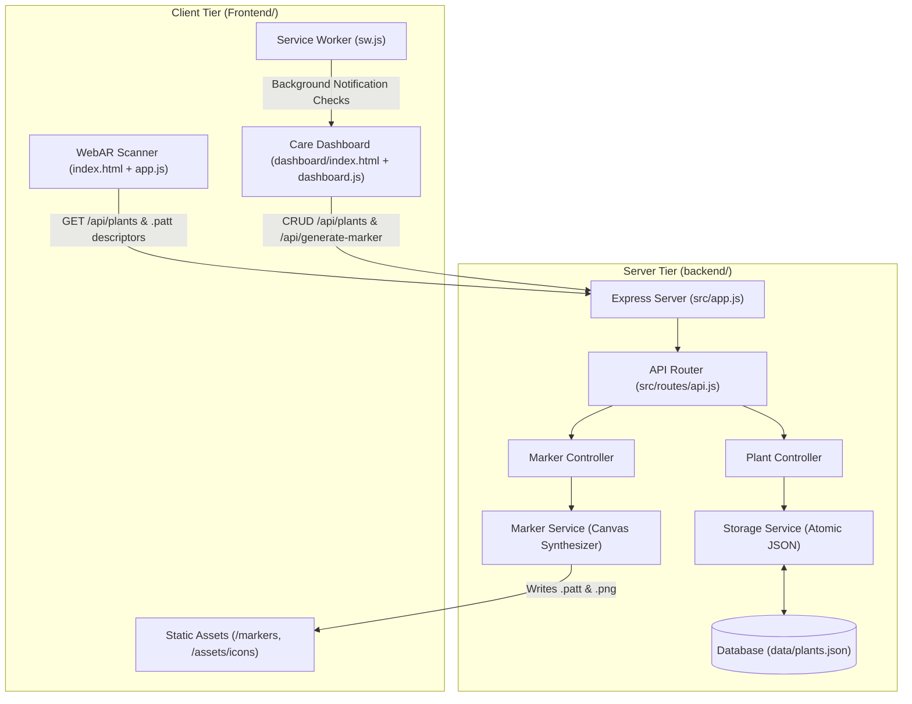

# 🌿 AR Plant Doctor

[](https://nodejs.org/)
[](https://expressjs.com/)
[](https://aframe.io/)
[](https://ar-js-org.github.io/AR.js-Docs/)
[-brightgreen?style=flat)](package.json)
[](LICENSE)

An Augmented Reality (WebAR) houseplant care, monitoring, and collection management application. Point your smartphone or webcam at a custom plant marker to view real-time watering schedules, urgency status, sunlight requirements, and care tips rendered in 3D directly above the pot.

---

## 1. Project Overview

**AR Plant Doctor** bridges indoor botany with spatial computing. It allows plant owners to view diagnostic health information and care requirements in-situ through a web browser without installing native mobile applications. Physical marker patterns attached to plant pots trigger floating 3D botanical digital twins and informational HUD cards that billboard toward the camera, highlighting whether a plant is healthy, due for water, or critically overdue.

---

## 2. Problem Statement & Purpose

### The Problem
Indoor houseplants frequently suffer and perish due to two primary issues:
1. **Inconsistent Care Routines:** Plant parents lose track of individual watering cycles across diverse species that each require distinct intervals (e.g. 7 days for Peace Lily vs 14 days for Snake Plant).
2. **Disconnected Records:** Care information is typically siloed in mobile apps or notebooks, separated from the physical plant. When standing in front of a plant, the owner has no immediate visual indicator of whether the soil needs moisture or if it was recently watered.

### The Purpose
AR Plant Doctor solves this by anchoring digital care intelligence directly onto the physical plant container via AR pattern markers. Owners can simply glance through their smartphone camera to instantly assess watering status, while managing collection analytics and printing new markers from an integrated botanical dashboard.

---

## 3. Verified Features

- 📱 **Real-Time WebAR Camera Scanner:**
  - Browser-based marker detection utilizing WebRTC webcam feeds.
  - Custom camera-facing billboarding component that keeps HUD cards oriented toward the user and compensates for mobile device tilt/orientation.
  - Procedural 3D botanical models including terracotta pot, soil, stem, swaying foliage leaves, and an animated blue water droplet that bobs over plants that are due or overdue.
  - Multi-tier information card displaying plant name, scientific classification, watering countdown, sunlight requirements, and care tips.
- 🎨 **Server-Side AR Pattern Synthesis:**
  - Procedural generation of 512×512 high-contrast printable pattern markers containing species identifiers and rotational accent shapes.
  - Automated sampling and encoding of standard 195-line, 4-orientation ARToolKit BGR pattern descriptors (`.patt`).
  - Automatic startup reconciler that detects and generates any missing pattern markers on boot.
- 📊 **Care Management Dashboard:**
  - Dark botanical UI design system with responsive layouts across desktop and mobile.
  - Single-page application architecture with Home, My Plants, Analytics, and Settings tabs.
  - Hero statistics displaying total plants, healthy count, needs-care count, and overdue count.
  - One-click "Water Now" logging that updates `lastWatered` and appends chronological records.
  - Plant CRUD capabilities (Add, Edit, View Detail, and Delete with automatic marker cleanup).
  - 30-day care activity tracking powered by Chart.js with a 7-day consistency streak metric.
- 🖨 **Integrated Marker Print Studio:**
  - Clean, dedicated pop-up print window with crisp pixelated scaling and print-ready quiet zones.
- 🔔 **Background Care Reminders:**
  - Service worker background notifications that alert users when plants become due or overdue.
- 💾 **Safe Atomic Storage:**
  - File-based persistence in `backend/data/plants.json` utilizing atomic write-then-rename routines to prevent database corruption.

---

## 4. Technology Stack

| Layer | Component | Version / Specification | Details |
| :--- | :--- | :--- | :--- |
| **AR & 3D Engine** | A-Frame | `1.4.0` (CDN) | WebGL 3D entity-component system |
| **AR Tracker** | AR.js | Master build (CDN) | ARToolKit pattern marker detection (`patternRatio: 0.75`) |
| **Frontend UI** | HTML5 / CSS3 / ES6+ | Modern Vanilla | Custom "Dark Botanical" CSS custom properties design system |
| **Data Viz** | Chart.js | `4.x` (CDN) | Horizontal bar chart tracking 30-day watering frequency |
| **Backend Framework** | Node.js / Express | Node `>=18.0.0`, Express `^5.2.1` | REST API, static asset server, marker training |
| **Pattern Synthesis** | `node-canvas` | `^3.2.3` | Cairo-backed server-side 2D drawing & BGR pattern encoder |
| **Data Store** | Flat-file JSON | Node `fs` (Atomic) | Isolated JSON document store (`backend/data/plants.json`) |
| **Automation** | Windows Command / Python | Batch / Python `3.8+` | `Start.bat`, `run_app.bat`, `run_app.py` |
| **Testing** | Node Test Runner | Native `node:test` | Zero-dependency unit and integration test suite |

---

## 5. Architecture Overview

AR Plant Doctor adopts a decoupled, two-tier architecture where the **Frontend** presentation tier is isolated from the **Backend** processing and data engine.



### Key Architectural Boundary Rules
1. **Public Static Isolation:** Express strictly serves the `Frontend/` directory as its static root. Backend source files, data files, launchers, and configuration are shielded from direct public HTTP access.
2. **Shared State via REST:** The AR Scanner and Dashboard communicate through unified REST endpoints (`/api/plants` and `/api/generate-marker`).
3. **Automatic Marker Invalidation:** When a plant is deleted through the dashboard, the backend automatically purges the associated `.patt` and `.png` files, and the AR scanner unregisters the marker dynamically without a page refresh.

---

## 6. Directory Structure

```text
AR-Plant-Doctor/
├── Frontend/                           # Complete Client-Side Presentation Tier
│   ├── assets/
│   │   └── icons/
│   │       ├── leaf.png                # Botanical icon for Service Worker notifications
│   │       ├── marker-1.png .. marker-6.png # Printable marker PNG images
│   │       └── .gitkeep
│   ├── dashboard/
│   │   ├── dashboard.css               # Dark Botanical UI design system styling
│   │   ├── dashboard.js                # State management, views, Chart.js, marker print
│   │   ├── index.html                  # Care dashboard SPA shell
│   │   └── sw.js                       # Service worker for background watering alerts
│   ├── markers/
│   │   ├── marker-1.patt .. marker-6.patt # Pre-trained ARToolKit pattern descriptors
│   │   └── .gitkeep
│   ├── app.js                          # WebAR controller, procedural 3D plant & HUD card
│   ├── index.html                      # WebAR camera scanner entry point (Served at /scanner & /ar)
│   └── style.css                       # AR camera transparent viewport & HUD styles
├── api/                                # Serverless Function Bridge for Cloud Hosting
│   └── index.js                        # Vercel serverless function exporting Express app
├── backend/                            # Server-Side Application & Data Engine
│   ├── data/
│   │   └── plants.json                 # JSON database with preserved user updates
│   ├── src/
│   │   ├── controllers/                # Route controllers (plantController, markerController)
│   │   ├── routes/                     # Consolidated Express API router (api.js)
│   │   ├── services/                   # Business logic (markerService, storageService)
│   │   ├── app.js                      # Express application setup & static asset routing
│   │   └── config.js                   # Environment & filesystem path constants
│   ├── tests/                          # Automated unit and integration tests (node --test)
│   │   ├── api.test.js
│   │   ├── markerService.test.js
│   │   └── storageService.test.js
│   └── server.js                       # Express backend server and startup reconciler
├── .env.example                        # Template environment variable configuration
├── .gitignore                          # Git ignore rules for node_modules, logs, and artifacts
├── init.md                             # Initialization and developer onboarding guide
├── LICENSE                             # MIT License file
├── package.json                        # Root npm configuration orchestrating backend
├── package-lock.json                   # Deterministic dependency lockfile
├── README.md                           # Main repository documentation
├── run_app.bat                         # Backward-compatible launcher forwarder
├── run_app.py                          # Cross-platform helper launcher (tunnel + browser)
├── Start.bat                           # Standardized Windows one-click launcher
└── vercel.json                         # Vercel deployment & routing configuration
```

---

## 7. Prerequisites & Runtime Versions

| Prerequisite | Minimum Version | Verified Host Runtime | Purpose |
| :--- | :--- | :--- | :--- |
| **Node.js** | `>= 18.0.0` | `v24.16.0` | Core backend runtime and native test runner |
| **npm** | `>= 9.0.0` | `12.0.2` | Dependency management |
| **Python** *(Optional)* | `>= 3.8.0` | `3.12.10` | Optional cross-platform launcher helper |
| **Camera** | WebRTC compatible | Built-in webcam / USB cam | AR marker scanning |
| **Browser** | Modern WebGL/WebRTC | Chrome, Edge, Safari, Firefox | Application client |

---

## 8. First-Time Installation & Setup

1. **Clone the Repository:**
   ```bash
   git clone https://github.com/JaiivantArvind/AR-Plant-Doctor.git
   cd AR-Plant-Doctor
   ```

2. **Install Dependencies:**
   ```bash
   npm install
   ```

3. **Verify Environment with Automated Tests:**
   ```bash
   npm test
   ```

---

## 9. Environment Variables & Configuration

Configuration is managed via [`backend/src/config.js`](backend/src/config.js). The server automatically adopts variables from a local `.env` file if present (via Node.js 20.6+ native `process.loadEnvFile()`).

A template is provided in [`.env.example`](.env.example):

```ini
# Server Port (Default: 3000)
PORT=3000

# Environment Mode (development / production)
NODE_ENV=development

# Relative Paths (relative to backend/src/)
DATA_FILE_PATH=../data/plants.json
FRONTEND_DIR=../../Frontend
MARKERS_DIR=../../Frontend/markers
ICONS_DIR=../../Frontend/assets/icons

# AR Pattern Synthesis Constants
MARKER_SIZE=512
MARKER_BORDER=64
PATTERN_RATIO=0.75
```

To customize your port or directory paths, copy `.env.example` to `.env`:
```cmd
copy .env.example .env
```

---

## 10. Running Through `Start.bat` (Windows — Recommended)

The primary Windows launcher is **[`Start.bat`](Start.bat)**. It requires no administrator privileges and handles end-to-end setup automatically:

```cmd
.\Start.bat
```

### What `Start.bat` Does Automatically:
1. Anchors to the project root directory.
2. Checks for Node.js (`>=18.0.0`) in `PATH` and common installation directories.
3. Automatically runs `npm install` if `node_modules\` is missing or incomplete.
4. Frees port 3000 if previously occupied by a stale process.
5. Verifies database integrity (`backend/data/plants.json`).
6. Starts the backend server in a dedicated window.
7. Actively polls `http://localhost:3000/api/plants` until the server responds with HTTP 200 OK.
8. Opens the **Care Dashboard** (default homepage) in your default web browser.
9. Automatically detects and spawns an `ngrok` tunnel if installed.
10. Keeps the window alive and cleanly terminates the server upon keypress.

*(Note: [`run_app.bat`](run_app.bat) is also retained as a backward-compatible forwarder).*

---

## 11. Manual Development & Execution Commands

### Start Server
```bash
npm start
```
Starts `backend/server.js` directly on port `3000`.

### Run Python Launcher Helper
```bash
python run_app.py
```
Starts the Express server, launches an `ngrok` tunnel if available, and opens browser tabs.

### Run Automated Tests
```bash
npm test
```
Executes the native Node.js test runner across all suites in `backend/tests/`.

---

## 12. Application URLs & API Endpoints

### Browser Interfaces

#### Production (Vercel Live Deployment)
- **Care Dashboard (Default Homepage):** [https://ar-plant-doctor.vercel.app](https://ar-plant-doctor.vercel.app)
- **WebAR Camera Scanner:** [https://ar-plant-doctor.vercel.app/scanner](https://ar-plant-doctor.vercel.app/scanner) (also at [/ar](https://ar-plant-doctor.vercel.app/ar))
- **REST API:** [https://ar-plant-doctor.vercel.app/api/plants](https://ar-plant-doctor.vercel.app/api/plants)

#### Local Development
- **Care Dashboard (Default Homepage):** [http://localhost:3000](http://localhost:3000) (also at [/dashboard](http://localhost:3000/dashboard))
- **WebAR Camera Scanner:** [http://localhost:3000/scanner](http://localhost:3000/scanner) (also at [/ar](http://localhost:3000/ar))

### REST API Endpoints

| Method | Endpoint | Description | Request Body | Response |
| :--- | :--- | :--- | :--- | :--- |
| `GET` | `/api/plants` | Retrieve all plant profiles and history | None | `200 OK` (JSON dictionary of plants) |
| `POST` | `/api/plants` | Save or update plant dictionary | JSON plant dictionary | `200 OK` `{ success: true, message: "..." }` |
| `DELETE`| `/api/plants/:id` | Delete plant `#id` and remove `.patt`/`.png` files | None | `200 OK` `{ success: true, message: "..." }` |
| `POST` | `/api/generate-marker` | Synthesize PNG & `.patt` marker files | `{ plantId: 1, plantName: "Peace Lily" }` | `200 OK` `{ success: true, imagePath, pattPath }` |

---

## 13. Primary Application Workflows

### Workflow 1: Inspecting a Plant in Augmented Reality
1. Open [http://localhost:3000/scanner](http://localhost:3000/scanner) locally, or open [https://ar-plant-doctor.vercel.app/scanner](https://ar-plant-doctor.vercel.app/scanner) directly on your desktop or mobile browser.
2. Allow camera access on the browser prompt.
3. Aim the camera at a printed plant marker.
4. The 3D botanical model (terracotta pot, soil, stem, and animated swaying leaves) will project on top of the marker.
5. If the plant is due or overdue for watering, an animated water droplet bobs above the plant.
6. The HUD card displays the plant species, care tip, sunlight requirement, and exact watering countdown.
7. Click the **Dashboard** button on the bottom bar to return to the care management dashboard.

### Workflow 2: Logging Care & Adding New Plants
1. Open [http://localhost:3000](http://localhost:3000) (or live at [https://ar-plant-doctor.vercel.app](https://ar-plant-doctor.vercel.app)).
2. On the **Home** tab, click **"Water Now"** on any plant to immediately record today's date into its historical log.
3. Switch to **My Plants** tab.
4. Fill out the "Add New Plant" form (Name, Scientific Name, Emoji, Interval, Sunlight, Tips) and submit.
5. The backend assigns the next numeric ID, saves to `plants.json`, and synthesizes its custom pattern descriptor and PNG marker on the fly.
6. Click **View** on the newly created plant card and click **Print Marker** to open the print studio.

### Workflow 3: Mobile Phone Scanning via Secure HTTPS
1. Open the live production HTTPS URL directly on your smartphone (iOS Safari / Android Chrome):
   ```text
   https://ar-plant-doctor.vercel.app/scanner
   ```
   *(No tunneling tools required; Vercel automatically provides a secure HTTPS context for camera access!)*
2. Or for local development with physical phones, launch a tunnel:
   ```bash
   npx localtunnel --port 3000
   # or
   npx ngrok http 3000
   ```
3. Allow camera access and point the phone camera at any printed marker.

---

## 14. Database & Storage Architecture

Data is stored locally in [`backend/data/plants.json`](backend/data/plants.json) as a JSON dictionary keyed by string IDs (`"1"`, `"2"`, etc.):

```json
{
  "1": {
    "name": "Peace Lily",
    "scientificName": "Spathiphyllum",
    "lastWatered": "2026-10-12",
    "wateringIntervalDays": 7,
    "sunlight": "Medium indirect light",
    "tips": [
      "Keep soil consistently moist but not soggy.",
      "Drooping leaves indicate it needs water immediately."
    ],
    "emoji": "🪴",
    "wateringHistory": [
      "2026-09-15",
      "2026-09-16",
      "2026-09-22",
      "2026-10-12"
    ]
  }
}
```

### Safety & Resilience Measures
- **Atomic File Writes:** [`backend/src/services/storageService.js`](backend/src/services/storageService.js) writes updates to `plants.json.tmp` first and performs an atomic rename to prevent corruption in the event of an abrupt power loss or process kill.
- **Client Offline Fallback:** If the backend is temporarily unreachable, [`Frontend/dashboard/dashboard.js`](Frontend/dashboard/dashboard.js) falls back to `localStorage` cache (`arpd_plants_cache`), ensuring continuous read/write capability in offline or static demo contexts.

---

## 15. Testing & Validation Commands

The test suite exercises all backend layers without third-party test runners:

```bash
npm test
```

### Verified Test Matrix (7/7 Passing):
- `API Integration`:
  - `GET /api/plants`: Validates JSON schema response and plant records.
  - `GET /`: Validates serving of Care Dashboard `Frontend/dashboard/index.html`.
  - `GET /scanner`: Validates serving of AR Scanner `Frontend/index.html`.
  - `GET /dashboard`: Validates serving of Care Dashboard `Frontend/dashboard/index.html`.
- `MarkerService`:
  - Validates 512×512 PNG buffer synthesis.
  - Validates ARToolKit 4-angle BGR pattern encoder producing exactly 195 lines.
  - Validates marker removal cleanup.
- `StorageService`:
  - Validates safe JSON parsing.
  - Validates rejection of invalid/corrupt payloads.

---

## 16. Troubleshooting

### Port 3000 is Already in Use
- **Automatic Resolution:** Running `Start.bat` automatically frees port 3000.
- **Manual Resolution (PowerShell):**
  ```powershell
  Get-NetTCPConnection -LocalPort 3000 -State Listen | ForEach-Object { Stop-Process -Id $_.OwningProcess -Force }
  ```

### Camera Shows a Black Screen
- **Browser Permissions:** Ensure camera access was granted in the browser address bar icon.
- **Insecure Context on Mobile:** Mobile browsers (iOS Safari & Android Chrome) block camera streaming over plain `http://<local-ip>:3000`. You **must** access via `localhost` (desktop) or an **HTTPS tunnel** (`ngrok` / `localtunnel`) on mobile devices.

### Marker Not Recognized
- **Lighting & Contrast:** Ensure the marker is printed clearly with a pure black border and pure white interior. Avoid glossy paper reflections.
- **Camera Distance:** Position the camera 20–40 cm away from the marker at an approximate 45° angle.

---

## 17. Known Limitations & Incomplete Features

1. **GitHub Pages Deployment Limitations:**
   - [`.github/workflows/deploy.yml`](.github/workflows/deploy.yml) deploys to GitHub Pages, which is a static file host. While the Dashboard functions in client-only demo mode using `localStorage`, server-side marker synthesis (`node-canvas`) and shared multi-client JSON synchronization require running the Node.js backend.
2. **Physical Optical Scanning:**
   - Optical tracking relies on client-side WebGL / AR.js pattern matching. Tracking stability depends on ambient room lighting and webcam focus.
3. **External CDN Dependencies:**
   - A-Frame and AR.js are loaded via CDN (`aframe.io` and `raw.githack.com`). For completely offline or air-gapped environments, vendoring these libraries into `Frontend/vendor/` is recommended as a future enhancement.

---

## 18. Security Considerations

- **No Secrets in Source:** No API keys, passwords, or cloud tokens exist or are required.
- **Protected Server Files:** Express strictly serves the `Frontend/` folder. Server source code (`backend/`), data stores, and launcher scripts cannot be downloaded over HTTP.
- **Payload Validation:** `storageService.js` strictly rejects malformed payloads (non-objects or arrays) to protect database integrity.
- **Safe Static Options:** All static Express routes ignore dotfiles (`{ dotfiles: 'ignore' }`).

---

## 19. Development & Maintenance Guidance

- **Adding Endpoints:** Place business logic in `backend/src/services/`, route handlers in `backend/src/controllers/`, and register routes in `backend/src/routes/api.js`.
- **Modifying AR Marker Layout:** If altering marker border widths or canvas dimensions, ensure `MARKER_SIZE`, `MARKER_BORDER`, and `patternRatio: 0.75` remain strictly synchronized across `backend/src/config.js`, `Frontend/index.html`, and `Frontend/app.js`.
- **Code Style:** Pure Vanilla JavaScript (ES6+), Vanilla CSS variables for theming, CommonJS for backend modules.

---

## 📄 License

This project is licensed under the [MIT License](LICENSE).
