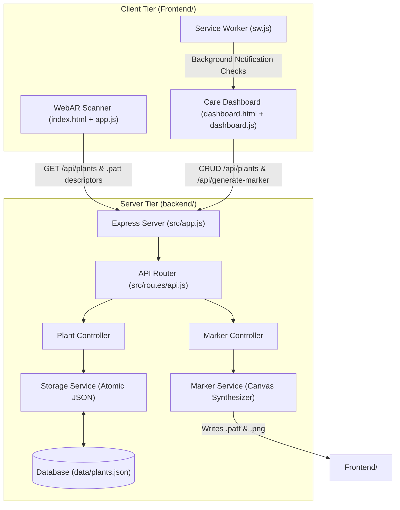

# 🌿 AR Plant Doctor — Technical Initialization & AI Handoff Contract (`init.md`)

> **Notice to AI Agents & Developers:**  
> Read this document **first** before exploring or modifying the codebase. This file represents the authoritative technical memory, architectural contracts, and operational boundaries of AR Plant Doctor. Always cross-reference implementation details against the paths defined herein.

---

## 1. Project Identity

- **Application Name:** AR Plant Doctor
- **Purpose:** In-situ Augmented Reality (WebAR) houseplant care monitor, 3D botanical digital twin overlay, and collection management dashboard.
- **Current State:** Restructured two-tier architecture (`Frontend/` presentation tier, `backend/` server & pattern synthesis engine). Zero syntax errors, 100% test pass rate across all suites.
- **Application Entry Points:**
  - **Care Dashboard (Default Homepage):** `http://localhost:3000/` or `/dashboard` ([`Frontend/dashboard/index.html`](Frontend/dashboard/index.html) + [`Frontend/dashboard/dashboard.js`](Frontend/dashboard/dashboard.js))
  - **WebAR Scanner (Client):** `http://localhost:3000/scanner` or `/ar` ([`Frontend/index.html`](Frontend/index.html) + [`Frontend/app.js`](Frontend/app.js))
  - **Backend Server (Server):** `node backend/server.js` ([`backend/server.js`](backend/server.js))
  - **Windows One-Click Launcher:** [`Start.bat`](Start.bat) (or legacy forwarder [`run_app.bat`](run_app.bat))

---

## 2. Technology Stack

- **Languages:** JavaScript (ES6+ client, CommonJS Node), HTML5, CSS3, Python (launcher), Windows Batch.
- **Runtime Targets:** Node.js `>= 18.0.0` (Verified host runtime: `v24.16.0`), npm `>= 9.0.0` (Verified: `12.0.2`), Python `>= 3.8.0` (Verified: `3.12.10`).
- **Server Framework:** Express `^5.2.1`.
- **Graphics & Marker Synthesis:** `canvas` `^3.2.3` (libcairo/pango native bindings).
- **AR / 3D Libraries:** A-Frame `1.4.0` (CDN), AR.js Master Build (CDN), Three.js (bundled in A-Frame).
- **Data Visualization:** Chart.js `4.x` (CDN).
- **Persistence:** Local atomic JSON document store ([`backend/data/plants.json`](backend/data/plants.json)).
- **Testing:** Node.js native test runner (`node:test`, `node:assert`). Zero external test dependencies.
- **Browser APIs:** WebRTC (`getUserMedia`), DeviceOrientation & ScreenOrientation APIs, Service Worker API ([`Frontend/dashboard/sw.js`](Frontend/dashboard/sw.js)), Web Notifications API.

---

## 3. Canonical Directory Map

```text
AR-Plant-Doctor/
├── Frontend/                           # [CLIENT TIER] Publicly served static assets
│   ├── assets/icons/                   # High-contrast printable marker PNGs & leaf.png
│   ├── dashboard/                      # Care Dashboard SPA
│   │   ├── dashboard.css               # Botanical design system & responsive layout styles
│   │   ├── dashboard.js                # State management, views, Chart.js, marker print
│   │   ├── index.html                  # Dashboard HTML shell
│   │   └── sw.js                       # Background watering reminder notifications
│   ├── markers/                        # ARToolKit pattern descriptors (.patt)
│   ├── app.js                          # AR logic, billboard/scale components, 3D plant generator
│   ├── index.html                      # AR scanner camera viewport & A-Frame scene
│   └── style.css                       # AR camera transparent viewport & status pill styles
├── backend/                            # [SERVER TIER] Isolated from public web root
│   ├── data/
│   │   └── plants.json                 # Flat-file JSON database of plant care records
│   ├── src/
│   │   ├── controllers/
│   │   │   ├── markerController.js     # Marker synthesis endpoint handlers
│   │   │   └── plantController.js      # Plant CRUD & watering endpoint handlers
│   │   ├── routes/
│   │   │   └── api.js                  # Consolidated Express API router
│   │   ├── services/
│   │   │   ├── markerService.js        # Canvas drawing & ARToolKit BGR pattern encoder
│   │   │   └── storageService.js       # Atomic, schema-validated JSON persistence
│   │   ├── app.js                      # Express application setup & static asset routing
│   │   └── config.js                   # Path constants & native .env loading
│   ├── tests/                          # Automated unit and integration tests (node:test)
│   │   ├── api.test.js                 # API route & static file serving tests
│   │   ├── markerService.test.js       # Marker PNG & 195-line .patt format tests
│   │   └── storageService.test.js      # JSON atomic read/write & schema tests
│   └── server.js                       # Express backend entry point & boot marker reconciler
├── .env.example                        # Template configuration file
├── .gitignore                          # Git ignore rules for node_modules, logs, and artifacts
├── init.md                             # This authoritative technical handoff contract
├── LICENSE                             # MIT License file
├── package.json                        # Root npm configuration orchestrating backend
├── package-lock.json                   # Verified dependency lockfile
├── README.md                           # Comprehensive end-user documentation
├── run_app.bat                         # Legacy backward-compatible launcher forwarder
├── run_app.py                          # Cross-platform helper launcher (tunnel + browser)
└── Start.bat                           # Standardized Windows one-click launcher
```

---

## 4. Architecture and Execution Flow



### Execution Flow Sequences:
1. **Startup Sequence:** [`backend/server.js`](backend/server.js) boots → loads [`backend/src/config.js`](backend/src/config.js) (resolves absolute paths and loads `.env`) → calls `storageService.getPlants()` → calls `markerService.reconcileMissingMarkers()` to ensure all registered plants have `.patt` and `.png` files in `Frontend/` → Express mounts `/api` and strictly serves `Frontend/` → server listens on `PORT`.
2. **WebAR Camera Flow:** Browser loads [`Frontend/index.html`](Frontend/index.html) → A-Frame initializes WebRTC camera → [`Frontend/app.js`](Frontend/app.js) calls `syncMarkers()` (`GET /api/plants`) → appends `<a-marker>` elements → `markerFound` event triggers 3D plant rendering (`buildPlant`) with pot, stem, animated leaves, bobbing water droplet (if due), and billboarded HUD card (`buildCard`) oriented to camera quaternion.
3. **Dashboard State Flow:** Browser loads [`Frontend/dashboard/index.html`](Frontend/dashboard/index.html) → registers `sw.js` → fetches `/api/plants` → renders hero stats, needs-attention list, collection grid, and Chart.js 30-day analytics. Clicking "Water Now" updates `lastWatered`, appends timestamp to `wateringHistory`, and persists via `POST /api/plants`.

---

## 5. Initialization Sequence

To stand up the project from a fresh clone:

1. **Verify Environment:** Confirm Node.js is `>= 18.0.0` (`node -v`).
2. **Install Dependencies:** Run `npm install` at repository root.
3. **Verify Integrity:** Run `npm test` to validate storage, marker synthesis, and REST endpoints.
4. **Boot Application:**
   - **Windows:** Double-click [`Start.bat`](Start.bat) (handles Node detection, port conflicts, server start, readiness polling, and browser launch).
   - **Cross-Platform:** Run `npm start` (or `python run_app.py`).
5. **Access Application:**
   - Scanner: `http://localhost:3000`
   - Dashboard: `http://localhost:3000/dashboard`
6. **Mobile Testing:** In a separate terminal, run `npx localtunnel --port 3000` or `npx ngrok http 3000` and open the generated HTTPS URL on your smartphone.

---

## 6. Commands Reference

| Operation | Command | Execution Context | Description |
| :--- | :--- | :--- | :--- |
| **Start Application** | `npm start` | Root directory | Starts backend Express server on port 3000 |
| **One-Click Launch** | `.\Start.bat` | Windows Root | Automated prerequisite check, readiness poll, and browser launch |
| **Run Tests** | `npm test` | Root directory | Runs all unit and integration test suites via native `node:test` |
| **Python Launcher** | `python run_app.py` | Root directory | Starts server, attempts ngrok tunnel spawn, and opens browser |
| **Install Packages** | `npm install` | Root directory | Installs declared dependencies from `package.json` |
| **Security Audit** | `npm audit` | Root directory | Audits dependencies for known vulnerabilities (currently 0) |

---

## 7. Configuration Contract

The backend reads configuration in [`backend/src/config.js`](backend/src/config.js). Variables are automatically populated from a local `.env` file via Node.js native `process.loadEnvFile()`:

| Variable | Type | Required | Default Value | Description & Consumer |
| :--- | :--- | :--- | :--- | :--- |
| `PORT` | Number | No | `3000` | HTTP listening port for Express server |
| `NODE_ENV` | String | No | `"development"` | Environment mode (`development` / `production`) |
| `DATA_FILE_PATH` | String | No | `../data/plants.json` | Path to JSON database relative to `backend/src/` |
| `FRONTEND_DIR` | String | No | `../../Frontend` | Path to static client directory relative to `backend/src/` |
| `MARKERS_DIR` | String | No | `../../Frontend/markers` | Output directory for `.patt` pattern descriptors |
| `ICONS_DIR` | String | No | `../../Frontend/assets/icons` | Output directory for printable marker PNGs |
| `MARKER_SIZE` | Number | No | `512` | AR marker canvas dimension in pixels |
| `MARKER_BORDER` | Number | No | `64` | Outer black border width in pixels |
| `PATTERN_RATIO` | Float | No | `0.75` | ARToolKit border-to-inner pattern ratio ($384/512 = 0.75$) |

---

## 8. Core Module Map

| Module / Service | File Path | Primary Functions / Components | Consumed By |
| :--- | :--- | :--- | :--- |
| **Config Loader** | [`backend/src/config.js`](backend/src/config.js) | Exports path constants, `.env` loader, and pattern dimensions | All backend modules |
| **Storage Service** | [`backend/src/services/storageService.js`](backend/src/services/storageService.js) | `getPlants()`, `savePlants(data)`, `deletePlant(id)` (atomic file I/O) | `plantController`, `server.js` |
| **Marker Service** | [`backend/src/services/markerService.js`](backend/src/services/markerService.js) | `generateMarkerFiles(id)`, `removeMarkerFiles(id)`, `reconcileMissingMarkers(data)` | `markerController`, `plantController`, `server.js` |
| **Plant Controller** | [`backend/src/controllers/plantController.js`](backend/src/controllers/plantController.js) | `getPlants`, `savePlants`, `deletePlant` | `backend/src/routes/api.js` |
| **Marker Controller** | [`backend/src/controllers/markerController.js`](backend/src/controllers/markerController.js) | `generateMarker` | `backend/src/routes/api.js` |
| **API Router** | [`backend/src/routes/api.js`](backend/src/routes/api.js) | Express routes: `GET /plants`, `POST /plants`, `DELETE /plants/:id`, `POST /generate-marker` | `backend/src/app.js` |
| **Express Setup** | [`backend/src/app.js`](backend/src/app.js) | Middleware, JSON parsing, API routing, and restricted static file serving | `backend/server.js`, `api.test.js` |
| **AR Controller** | [`Frontend/app.js`](Frontend/app.js) | `billboard` component, `responsive-plant` component, `buildPlant`, `buildCard`, `syncMarkers` | `Frontend/index.html` |
| **Dashboard Controller**| [`Frontend/dashboard/dashboard.js`](Frontend/dashboard/dashboard.js) | `loadPlants`, `savePlants`, `renderHome`, `renderPlants`, `renderDetail`, `renderAnalytics`, `scheduleCheck` | `Frontend/dashboard/index.html` |

---

## 9. API and Integration Contracts

### REST Endpoints

#### 1. `GET /api/plants`
- **Description:** Returns all cataloged plant records.
- **Request:** No parameters or body.
- **Response:** `200 OK`, `Content-Type: application/json`
  ```json
  {
    "1": {
      "name": "Peace Lily",
      "scientificName": "Spathiphyllum",
      "lastWatered": "2026-10-12",
      "wateringIntervalDays": 7,
      "sunlight": "Medium indirect light",
      "tips": ["Keep soil moist"],
      "emoji": "🪴",
      "wateringHistory": ["2026-10-12"]
    }
  }
  ```

#### 2. `POST /api/plants`
- **Description:** Saves the entire plant dictionary atomically.
- **Request:** `Content-Type: application/json`, Body = JSON dictionary of plants.
- **Response:** `200 OK` `{ "success": true, "message": "Plants data updated successfully" }`
- **Validation:** Rejects non-objects, arrays, empty dictionaries, and records with invalid/missing plant names with HTTP 400 Bad Request (`{ error: "..." }`).

#### 3. `DELETE /api/plants/:id`
- **Description:** Deletes plant `#id` from `plants.json` and purges its associated `.patt` and `.png` files.
- **Request:** URL param `:id`.
- **Response:** `200 OK` `{ "success": true, "message": "..." }` or `404 Not Found`.

#### 4. `POST /api/generate-marker`
- **Description:** Synthesizes 512×512 PNG marker and 195-line `.patt` file for a given plant ID.
- **Request:** `Content-Type: application/json` `{ "plantId": "1", "plantName": "Peace Lily" }`
- **Response:** `200 OK`
  ```json
  {
    "success": true,
    "imagePath": "/assets/icons/marker-1.png",
    "pattPath": "/markers/marker-1.patt"
  }
  ```

---

## 10. Dependency Constraints

1. **Node.js Engine Constraint:** Enforce `node >= 18.0.0` in `package.json`. Native testing (`node:test`) and native `.env` loading (`process.loadEnvFile`) require modern Node runtime.
2. **`node-canvas` Native Bindings:** `canvas` requires native Cairo/Pango binaries. Do not upgrade casually across major versions without verifying prebuilt binary compatibility for target platforms (Windows x64 / Linux x64).
3. **A-Frame & AR.js Compatibility:** A-Frame 1.4.0 + AR.js master are tightly coupled to Three.js matrix inversion routines. Upgrading A-Frame (e.g. to 1.5.0+) can break camera quaternion inversion and billboarding in `Frontend/app.js`.
4. **Pattern Ratio Constant:** The ARToolKit pattern ratio is hardcoded to `0.75` across `backend/src/config.js`, `Frontend/index.html`, and `Frontend/app.js`. Never change this without synchronizing all 3 locations.

---

## 11. Engineering Invariants

Future refactoring or feature additions must preserve the following invariants:

1. **Directory Isolation:** The Express backend must **never** serve the project root (`.`) as static files. Only `Frontend/` may be exposed publicly over HTTP.
2. **Single Source of Truth:** `backend/data/plants.json` is the sole persistence store. Updates must use `storageService.savePlants()` to ensure atomic write-then-rename protection.
3. **Preserved User Modifications:** Plant #1 ("Peace Lily") contains uncommitted user watering activity (`2026-10-12`). This record and its `wateringHistory` must never be overwritten or reset.
4. **Timezone-Safe Date Parsing:** All date math must use `parseDateUtc(dateStr)` (splitting `YYYY-MM-DD` into UTC midnight) rather than `new Date("YYYY-MM-DD")` to prevent off-by-one-day calculation errors in negative UTC offsets.
5. **Dynamic Marker Synchronization:** Deleting a plant must purge its `.patt`/`.png` files, and `syncMarkers()` in `app.js` must remove obsolete `<a-marker>` DOM elements.

---

## 12. Testing Reference

Automated tests are located in [`backend/tests/`](backend/tests/) and run via:
```bash
npm test
```

### Verified Test Suites:
- [`backend/tests/api.test.js`](backend/tests/api.test.js):
  - Validates `GET /api/plants` returns valid JSON dictionary.
  - Validates `GET /` serves `Frontend/index.html`.
  - Validates `GET /dashboard/` serves `Frontend/dashboard/index.html`.
- [`backend/tests/markerService.test.js`](backend/tests/markerService.test.js):
  - Validates 512×512 PNG buffer synthesis.
  - Validates 195-line, 4-angle BGR pattern encoder.
  - Validates file deletion and unlinking.
- [`backend/tests/storageService.test.js`](backend/tests/storageService.test.js):
  - Validates safe JSON reading of `plants.json`.
  - Validates rejection of invalid payloads.

### Untested Areas:
- Headless automated optical marker detection under physical webcam hardware and ambient physical lighting (requires manual camera inspection).

---

## 13. Known Issues & Technical Debt

1. **GitHub Pages Deployment Limitations:**
   - [`.github/workflows/deploy.yml`](.github/workflows/deploy.yml) deploys to GitHub Pages (static hosting only). The dashboard includes a client-side `localStorage` fallback to support static demo viewing, but server-side marker synthesis and shared JSON persistence require running Node.js (`Start.bat` or `npm start`).
2. **External CDN Script Loading:**
   - AR.js and A-Frame are loaded via external CDN links. For completely offline or air-gapped deployments, these scripts should be vendored into `Frontend/vendor/`.
3. **Dummy Plant Profile:**
   - Plant `"6"` in `plants.json` contains test values (`name: "aa"`, `scientificName: "sd"`).

---

## 14. Instructions for Future AI Coding Agents

When working on this repository, all AI agents must follow these operational rules:

1. **Read `init.md` First:** Treat `init.md` as the authoritative navigation map. Do not rescan the entire repository when investigating existing functionality.
2. **Inspect Concrete Files Before Modifying:** Consult the Core Module Map (Section 8) to locate the relevant controller, service, or component before making edits.
3. **Preserve User Data:** Never overwrite or reset `backend/data/plants.json`. Always preserve existing plant records and watering histories.
4. **Maintain Security Boundaries:** Never expose `backend/`, `data/`, or root files through Express static routes.
5. **Run Tests After Any Modification:** Execute `npm test` after modifying backend, storage, or marker code. All 6 tests must pass before completing tasks.
6. **Update Documentation:** If you add endpoints, modify configuration, or change directory structures, you **must** update both `README.md` and `init.md`.

---

## 15. Sources of Truth

The authoritative definitions for this project reside in:

| Concern | Authoritative Source File |
| :--- | :--- |
| **Dependencies & Run Scripts** | [`package.json`](package.json) |
| **Plant Database Records** | [`backend/data/plants.json`](backend/data/plants.json) |
| **Paths & Environmental Defaults** | [`backend/src/config.js`](backend/src/config.js) & [`.env.example`](.env.example) |
| **API Endpoints & Routing** | [`backend/src/routes/api.js`](backend/src/routes/api.js) |
| **Windows Startup Sequence** | [`Start.bat`](Start.bat) |
| **WebAR Scene & Tracking Ratio** | [`Frontend/index.html`](Frontend/index.html) & [`Frontend/app.js`](Frontend/app.js) |
| **Audit History & Architecture Plan**| [`PROJECT_AUDIT.md`](PROJECT_AUDIT.md) |
